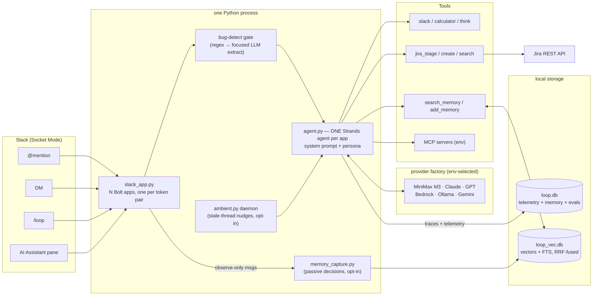
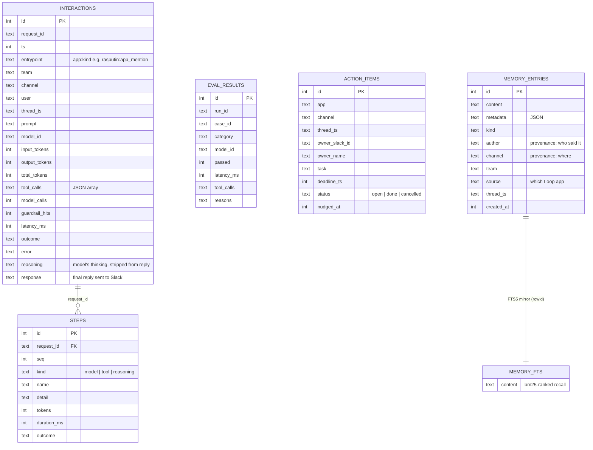

#  Loop

A Slack-native AI agent built on [Strands Agents](https://strandsagents.com/), running on **MiniMax M3** (via its Anthropic-compatible endpoint).

When you `@mention` the bot (or invoke `/loop`), a single Strands agent thinks, optionally uses a tool, and replies in the thread. It remembers things in long-term memory, reads files you attach, and can run as **several distinct Slack apps at once** from one process.

There is **one brain** — the agent. No intent parser, no command router, no extraction pipeline.

---

## Highlights

| Capability | What it means |
|---|---|
| 🤖 **Strands agent** | One agent loop decides what to do; replies in Slack `mrkdwn`. |
| 🧠 **Episodic memory** | Crucial facts/decisions/episodes persisted in SQLite, each **stamped with who/where/when**; auto-injected (with provenance) before each reply. The agent is the filter — it saves signal, skips chit-chat, and de-dupes. |
| 🔎 **Hybrid RAG recall** | Optional libSQL/**Turso** backend fusing **FTS5 (lexical) + semantic vectors** via Reciprocal Rank Fusion. Local embeddings (`fastembed`) — **no API key**. `CAIRN_MEMORY_BACKEND=hybrid`. |
| ✨ **Slack AI Assistant** | Native Slack AI app pane — suggested prompts + live "is thinking…" status, routed to the same agent. `CAIRN_SLACK_ASSISTANT=on`. |
| 👥 **Multi-app support** | Run **Loop _and_ Rasputin_Loop** (and more) in one process — each its own bot, its own agent, its own persona. |
| 📎 **File & image reading** | Images go to the model natively (M3 is multimodal); text/code/JSON inlined; PDFs extracted (`pypdf`). |
| 🎫 **Jira auto-triage** | Detects bug reports in Slack → extracts title/priority/assignee → confirms with user → creates Jira ticket. Smart assignee routing: `<@mention>` → Slack email → Jira account ID, fully automatic. |
| 🛠️ **Tools** | `slack`, `slack_send_message`, `calculator`, `think`, `jira_stage_ticket`, `jira_create_issue`, `jira_search_issues`, plus runtime **MCP** tools. |
| 🔭 **Observability** | Per-interaction telemetry + per-step traces, persisted to SQLite. |
| 🛡️ **Guardrails** | Tool-call caps, repeat limits, token budget, and a risky-Slack-method blocklist. |
| ✅ **Evaluation** | `loop-eval` runs a golden set through the real agent and gates on regressions. |

See [`architecture.md`](architecture.md) for how it's wired and [`progress.md`](progress.md) for the roadmap (mapped to the 5 Pillars of Production AI).

---

## Showcase

Two self-contained HTML pages live in [`docs/`](docs/) (open them directly in a browser):

| Page | Audience | What's inside |
|---|---|---|
| [`docs/presentation.html`](docs/presentation.html) | **Presenting** (hackathon stage, projector) | Keynote-style scroll deck: thesis, problem, the three verbs, demo moments, differentiation, numbers. |
| [`docs/field-guide.html`](docs/field-guide.html) | **Knowledge base** (prep + judges' Q&A) | Every capability with its literal Slack trigger, 7-step demo run order, positioning table, Knowns / Known-Unknowns / Unknowns map, pre-demo checklist. |

## Architecture at a glance



## Data model (ER)

`loop.db` (SQLite — telemetry, evals, action items, and the default memory backend):



`loop_vec.db` (libSQL — the hybrid backend, `CAIRN_MEMORY_BACKEND=hybrid`): the same
`memory_entries` shape **plus** an `embedding F32_BLOB(384)` column with a native
vector index, and its own FTS5 mirror; lexical + semantic results are fused via
Reciprocal Rank Fusion at query time.

---

## Multi-app support (Loop + Rasputin_Loop)

Loop can run **one or many** Slack apps in a single process. Each configured app gets its own Bolt App, its own Socket Mode connection (own thread), and its own agent — but they share code, memory, and telemetry.

- **One app (back-compat):** set the bare `SLACK_BOT_TOKEN` + `SLACK_APP_TOKEN` (label it with `SLACK_APP_NAME`, default `loop`).
- **Many apps:** add a `SLACK_BOT_TOKEN_<NAME>` + `SLACK_APP_TOKEN_<NAME>` pair per app.

Give each app a different job with **`CAIRN_PERSONA_<NAME>`**, which is appended to that app's system prompt:

```bash
CAIRN_PERSONA_LOOP=You are the team's general assistant.
CAIRN_PERSONA_RASPUTIN=You are the on-call incident assistant; be terse and precise.
```

Telemetry tags every interaction `"<app>:<entrypoint>"` (e.g. `rasputin:app_mention`) so the apps stay distinguishable.

---

## Tools & privileges

| Tool | Source | Purpose |
|---|---|---|
| `slack` | `strands_tools.slack` | Any Slack Web API method (read/post messages, list users, look up channels). |
| `slack_send_message` | `strands_tools.slack` | Convenience wrapper for posting a message. |
| `search_memory` / `add_memory` | Strands `MemoryManager` | Long-term memory recall (auto-injected) and writes. |
| `calculator` | `strands_tools.calculator` | Math. |
| `think` | `strands_tools.think` | Structured reasoning for hard problems. |
| *(MCP tools)* | `CAIRN_MCP_SERVERS` | Any stdio MCP server's tools, loaded at runtime. |

**Required Slack bot scopes:** `app_mentions:read`, `chat:write`, `commands`, `reactions:write`, `files:read`, `channels:history`, `groups:history`, `im:history`, `users:read`, `users:read.email` (assignee-by-name → email resolution). For the native **AI Assistant** pane add `assistant:write` + enable the "Agents & AI Apps" feature (see [`docs/slack-assistant.md`](docs/slack-assistant.md)); for ambient full-channel discovery without an allow-list add `channels:read`.

---

## Setup

### 1. Install

```bash
python3 -m venv .venv
source .venv/bin/activate
pip install -e .
```

### 2. Configure the Slack app(s)

For **each** app at <https://api.slack.com/apps>:

1. **OAuth & Permissions** → add the bot scopes above → **Install / Reinstall**, copy the **Bot User OAuth Token** (`xoxb-…`).
2. **Basic Information → App-Level Tokens** → Generate one with `connections:write`, copy it (`xapp-…`).
3. **Socket Mode** → **Enable** _(do this first — it removes the Request URL requirement on the next step)_.
4. **Event Subscriptions** → Enable → **Subscribe to bot events**: `app_mention`, `message.im` → **Save Changes** → reinstall if prompted.
5. Invite the bot to channels: `/invite @YourApp`.

> If `@YourApp` never reacts: the socket connects but **Event Subscriptions / Socket Mode** aren't set for that app — that's the #1 silent-bot cause.

### 3. Configure `.env`

```bash
cp .env.example .env
```

```dotenv
# ── Single app ──
SLACK_BOT_TOKEN=xoxb-...
SLACK_APP_TOKEN=xapp-...
SLACK_APP_NAME=loop

# ── Or multiple apps ──
SLACK_BOT_TOKEN_LOOP=xoxb-...
SLACK_APP_TOKEN_LOOP=xapp-...
SLACK_BOT_TOKEN_RASPUTIN=xoxb-...
SLACK_APP_TOKEN_RASPUTIN=xapp-...

# ── Model: MiniMax M3 via the Anthropic-compatible endpoint ──
ANTHROPIC_API_KEY=                 # your MiniMax key (or ANTHROPIC_AUTH_TOKEN)
ANTHROPIC_BASE_URL=https://api.minimax.io/anthropic
ANTHROPIC_MODEL=MiniMax-M3

# ── Storage ──
DATABASE_PATH=./data/loop.db
```

See [`.env.example`](.env.example) for every knob (personas, guardrails, observability, file-size cap, MCP).

### 4. Run

```bash
loop
```
```
loop: Slack app 'rasputin' connected (socket mode)
loop: Slack app 'loop' connected (socket mode)
loop: 2 app(s) running: rasputin, loop
```

---

## Commands

| Command | What it does |
|---|---|
| `loop` | Start the agent and connect every configured Slack app. |
| `loop-eval` | Run `evals/golden.json` through the real agent; scores tool selection + reply content; exits non-zero on regression. Flags: `--limit`, `--case`, `--json`. |

---

## Production harness

Loop ships with the foundations for running an agent in production (see [`progress.md`](progress.md) for the full 5-Pillars roadmap):

- **Observability** — every interaction emits a JSON telemetry line + an `interactions` row; every model call, tool call, and reasoning chunk emits a trace + a `steps` row. `LOG_LEVEL=DEBUG` shows full reasoning + tool I/O.
- **Guardrails** — per-request circuit breakers (max tool calls, repeated calls, token budget) and a destructive-Slack-method blocklist, each toggled by env.
- **Evaluation** — a golden set + `loop-eval` CI gate so a model/prompt swap can't silently regress quality.

---

## Database

Local **SQLite** at `DATABASE_PATH` (default `./data/loop.db`), no external services. Tables: `memory_entries` (long-term memory — provenance columns `author/channel/team/source/thread_ts/kind` + `metadata` JSON), `memory_fts` (FTS5 mirror for ranked recall), `interactions` (edge telemetry), `steps` (per-step traces), `eval_results` (eval runs), `action_items`. The databases are **runtime state and are not tracked in git** (never `git checkout`/`stash` over a live DB — it swaps the file under the running process); the schema is created and migrated by code on boot. See the ER diagram above.

Memory is **episodic and provenance-stamped**: the `add_memory` tool only carries content, so the store auto-attaches *who said it, in which channel/workspace, via which app, and when* (from the request) — recall can then say "_per @alice in #infra on 2026-06-20_". Default search is **FTS5** (`bm25()` + recency) with a sanitized, injection-safe query and a `LIKE` fallback; exact-duplicate content is de-duped on write. Run the storage tests with `python -m tests.test_memory` (no pytest/key needed).

**Hybrid RAG (optional):** set `CAIRN_MEMORY_BACKEND=hybrid` (after `pip install -e ".[vector]"`) to recall over **libSQL/Turso**, fusing FTS5 (lexical) with semantic vector search (`F32_BLOB`/`vector_top_k`) via Reciprocal Rank Fusion — so *"where's the outage runbook?"* finds *"the playbook lives in Notion under SRE"* even with no shared words. Embeddings default to local **`fastembed`** (no API key). See [`docs/vector-memory.md`](docs/vector-memory.md). For the native **Slack AI Assistant** pane, see [`docs/slack-assistant.md`](docs/slack-assistant.md).

---

## Project layout

```
loop/
  main.py          # entrypoint — loads .env, starts the Slack app(s)
  slack_app.py     # multi-app discovery + Socket Mode handlers, file download,
                   # bug-detection shortcut + Jira confirmation interceptor
  agent.py         # builds one Strands agent per app (+ persona), runs it
  jira_tool.py     # native Jira tools: jira_stage_ticket, jira_create_issue,
                   # jira_search_issues; smart assignee routing (Slack→email→Jira)
  storage.py       # SqliteMemoryStore — episodic, provenance-stamped, FTS5 recall
  vector_store.py  # HybridMemoryStore — libSQL/Turso FTS5 + vector (RRF) hybrid RAG
  embeddings.py    # pluggable embedder (fastembed local / minimax / openai / hashing)
  context.py       # per-request state (ContextVar) for hooks
  tracing.py       # step traces (LoopTracer) + reasoning callback
  guardrails.py    # tool-call circuit breakers
  observability.py # interaction/step/eval telemetry + SQLite tables
  eval.py          # `loop-eval` runner
evals/golden.json  # golden eval set
tests/             # storage-layer tests (memory + hybrid; no pytest/key needed)
docs/              # vector-memory.md (hybrid RAG) · slack-assistant.md
architecture.md    # how it's wired (source of truth)
progress.md        # status + 5-Pillars roadmap
```

---

## Jira auto-triage

Loop detects bug reports as they're written in Slack — no right-clicking, no forms. The flow:

1. Someone says `@Rasputin_Loop login crashes on mobile — @john should fix this`
2. Bot detects bug keywords → makes a focused LLM call to extract structured details
3. Shows confirmation: title, type, priority, assignee
4. User replies `@Rasputin_Loop yes`
5. Ticket created in Jira, assigned to John (resolved via Slack email → Jira account ID)

```dotenv
# Required in .env
JIRA_URL=https://yourorg.atlassian.net
JIRA_USERNAME=you@yourorg.com
JIRA_API_TOKEN=your-api-token        # https://id.atlassian.com/manage-profile/security/api-tokens
TOOLSETS=jira_issues                 # limits MCP to 8 tools (keeps context small)
```

The project key (`KAN` by default) is set in `CAIRN_PERSONA_*` in `.env`. This feature does **not** go through the agent for bug detection or ticket creation — it runs as a deterministic shortcut in `slack_app.py` so it works reliably regardless of model behavior.

---

## Adding MCP tools at runtime

```bash
# Single server
CAIRN_MCP_SERVERS="uvx mcp-server-fetch" loop

# Multiple servers — semicolon-separated, all loaded on every agent call
CAIRN_MCP_SERVERS="uvx mcp-server-fetch;uvx mcp-atlassian --transport stdio" loop

# Per-app: only Rasputin gets Google Drive tools, Loop gets fetch
CAIRN_MCP_SERVERS="uvx mcp-server-fetch"
CAIRN_MCP_SERVERS_RASPUTIN="uvx mcp-google-drive"
```
The agent enters all MCP contexts per invocation via `contextlib.ExitStack`, merges every server's tools alongside built-ins, and exits cleanly — no code changes needed to add a server. Env vars are forwarded to each subprocess so credentials work.
