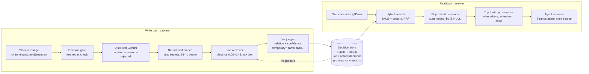

# Cairn — Overview

_As of 2026-10-08_

---

## The pitch

**30 seconds.** Teams make decisions in Slack and then lose them. Cairn is a Slack agent that reads channel conversations without being mentioned, works out which ones contained a decision, and stores that decision with its reasoning and its source. Months later you ask "why did we pick Postgres?" and it answers with the decision, the reason, who said it, where and when. Two things make it more than a search wrapper: the citation is attached by code, so the model cannot fake it, and it knows when a decision has been overturned and stops serving the old one.

**2 minutes, add these.**

- It is a RAG system, but what it retrieves is a distilled decision, not a document chunk, and retrieval is hybrid: keyword search (BM25) plus vector search, merged with Reciprocal Rank Fusion.
- The hardest problem was deciding whether a new decision replaces an old one. Embedding distance cannot tell "same decision reworded" from "decision changed", because the two ranges overlap. So distance decides when to ask, and a classifier decides the relation.
- The LLM classifier gave different answers on the same input. I replaced it with Jev, TypeSafe AI's "System One" model, which returns typed answers with confidence. On its own Jev made the same mistakes, so I built checks around TypeSafe's documented guidance.
- Result on 73 unseen test pairs: the LLM judge would have wrongly deleted 13 valid decisions; Jev with the checks, 0.
- It has a real production harness: step-level tracing, guardrails that block tool calls, an eval set, and a provider switch that moved the whole system between model vendors with no code change.

---

## The problem

Decisions are made in Slack and then lost in Slack, so teams re-argue settled questions. It bites in three moments:

| Moment | What happens today |
| --- | --- |
| New hire, week 2 | Asks a question whose answer exists; someone types it out for the fourth time |
| Design review, month 6 | "Didn't we decide this?" Nobody can find it, the debate re-runs |
| Someone leaves | The code stays; the reasoning leaves with them |

**Why Slack search fails.** It matches words. A real decision looks like "yeah ok let's do that", message 47 of a thread about something else. And people need the *why*, which sits in the messages before the conclusion.

**Why "just write it down" fails.** Every tool that asks people to mark decisions demos well and dies in week two. The moment a decision is made is the moment nobody wants to stop and file it. So capture has to be passive.

**Why the hard part is change.** Decisions get revised: "24-hour review" becomes "4-hour review". If the old one keeps being served, the bot gives a confident, cited, wrong answer. A wrong answer with a real citation is worse than no answer, because it looks checked.

---

## How it works end to end

Harness around it all: step tracing, guardrails on tool calls, evals.

On the way in, a free regex gate means most messages cost nothing; only likely decisions get a model call, and only near-matches (the 4 closest live decisions) reach Jev. On the way out, both searches pass through one filter that drops retired decisions, so a replaced answer is never served. Who, where and when are attached by code at write time, so the citation in the answer cannot be invented.

---

## Tech stack and AI concepts

Every concept below is used in the code, not just named.

| Layer | Choice | Why |
| --- | --- | --- |
| Language | Python 3.12 | Ecosystem for agents and ML |
| Agent framework | Strands Agents (AWS) | Agent loop, tool schemas, provider abstraction and hook points I would otherwise write badly myself |
| Slack | slack_bolt, Socket Mode | No public URL or webhook needed |
| Generative model | Env-selected; Gemini 3.5 Flash-Lite in use | One variable switches Anthropic, Gemini, OpenAI, Bedrock, Ollama, LiteLLM |
| Relation judge | Jev 1.13 (TypeSafe AI) | Typed answers with confidence, same answer on repeat |
| Store | SQLite + libSQL vector index | One file, no service to run |
| Embeddings | fastembed, BAAI/bge-small-en-v1.5, 384 dimensions, local | No API key, no per-call cost, data stays local |
| Keyword search | SQLite FTS5 with BM25 | Exact tokens: ticket IDs, names, error codes |
| Integrations | Jira REST, MCP | Tickets cite the decision they came from |

**Concepts, in one line each, and where they live:**

- **Agent:** a model that calls tools in a loop (think, call, read, answer). One agent, no router or intent classifier. `cairn/agent.py`
- **Tools:** Python functions whose docstrings are the model's manual. Switchable with `CAIRN_TOOLS`, because every tool schema is re-sent on every request; removing one unused tool saved about 2,100 tokens per message.
- **RAG:** retrieve relevant memories, inject them into the prompt, answer from them. Done automatically before every reply (top 5 memories).
- **Distillation instead of chunking:** one model call turns a whole conversation into 2 to 4 sentences: what was decided, why, what was rejected. `cairn/memory_capture.py`
- **Embeddings:** text to 384 numbers so meaning becomes distance. `cairn/embeddings.py`
- **Hybrid retrieval + RRF:** keyword and vector search both run; Reciprocal Rank Fusion merges them by rank, score = 1/(60 + rank) from each list. Ranks are used because BM25 scores and cosine distances are on different scales. `cairn/vector_store.py`
- **Short-term vs long-term memory:** short-term = the Slack thread, re-read every turn; long-term = the decision store.
- **Provenance:** who, where, when, taken from Slack's event payload by code and attached by the store.
- **Guardrails:** hooks that cancel a tool call before it runs: call limits, repeated calls, token budget, destructive Slack methods. `cairn/guardrails.py`
- **Observability:** every model call, tool call and reasoning step logged to SQLite (`interactions`, `steps`). `cairn/tracing.py`
- **Evals:** behaviour tests through the real agent (35 golden cases), plus a labelled-pair eval for the relation judge. `cairn/eval.py`, `evals/measure_classifier.py`
- **MCP:** a standard for plugging external tool servers into an agent. Supported, off by default.

---

## Key design decisions

Every decision follows one principle: deleting a valid decision is invisible and permanent, keeping an extra one is visible and fixable, so when unsure, keep both.

| Decision | What I chose | Rejected alternative | Why |
| --- | --- | --- | --- |
| Citations | Code attaches who/where/when from Slack's payload; the memory tool takes only the text | Let the model cite its sources | A model can invent a citation in the same confident format as a real one. With no field for an author, it cannot supply a wrong one |
| Forgetting | Replaced decisions are retired (`superseded_by`), never deleted; retirement follows whole chains (24h, 4h, 8h leaves one live) | Append-only memory | Stale but cited answers look trustworthy. One SQL line, `WHERE superseded_by IS NULL`, sits in the single path both searches use |
| Unit of memory | A distilled decision from the whole conversation | Raw chunks, or only the last line | Raw text keeps the words and loses the point; the last line keeps the point and loses the reason |
| Capture | Passive: a free regex gate, then one model call | Ask people to tag decisions | Manual tagging dies in week two |
| Retrieval | Keyword + vector, merged with RRF | Vector only | Vectors miss exact tokens like PROJ-142; keywords miss paraphrases |
| Thresholds | Measured on a 44-decision corpus (distance under 0.08 = duplicate for free; 0.08 to 0.45 = ask the judge) | Picked by feel | First numbers from a 3-memory store were wrong; re-measured with a script anyone can rerun |
| Relation judge | Jev + checks, thresholds from TypeSafe's docs | Keep the LLM judge | LLM flipped answers and gives no confidence to build safety rules on |
| Short-term memory | Re-read the Slack thread every turn, reset agent history | Let the cached agent accumulate history | A cached agent leaked every user's turns into every later request |
| Brain | One agent, no router | Intent classifier + specialist agents | The model decides; guardrails constrain it. Fewer moving parts to go wrong |
| Off-the-shelf memory | Built it | mem0, Zep, LangMem | They do extraction and retrieval, but not citations the model cannot touch, supersession chains, or passive Slack capture. Name them first in an interview |

---

## The Jev story

Jev on its own made the same mistakes as the LLM; what fixed them was asking the exact conditions directly and following TypeSafe's own thresholds, which took wrong deletions on unseen data from 16 to 0.

**1. The job.** When a new decision is similar to a stored one (distance 0.08 to 0.45), decide: **duplicate** (keep one), **replaces** (retire the old), or **independent** (keep both).

**2. Why move off the LLM.** The Gemini judge gave opposite verdicts on the same pair across two runs. Temperature 0 and caching verdicts were workarounds, not fixes.

**3. What Jev is.** TypeSafe AI's "System One" model, launched September 2026. It does not write text. You send a state and typed questions (choice, yes/no, score); it returns the answer, a probability per option and a confidence, in one call. For three options, confidence = (3 × top probability − 1) ÷ 2, so a 53/45 split gives 0.29.

**4. How the testing went.**

| Step | Test | What happened | What I did |
| --- | --- | --- | --- |
| 1 | Easy set, 14 pairs | 14/14 | Noticed the sentences had giveaway words ("cut from 24 to 4 hours"); stopped trusting it |
| 2 | Live Slack | 7/7 correct, 389 to 884 ms each | Also exposed a capture bug (see bugs) |
| 3 | Hard set, 16 pairs, no cue words | Deleted "standups are async on Fridays" on reading "daily standup is at 10:00", at 0.96 | Found TypeSafe documents this: "literal reading" |
| 4 | Blind set 1, 20 pairs, labels hidden from the builder | One-offs ("for this week's launch") treated as permanent; exceptions treated as replacements | V2: two yes/no checks in the same call |
| 5 | V2 | One-offs fixed; exceptions not, because "same case?" scores overlapped | V3: TypeSafe's thresholds + true/false descriptions |
| 6 | Blind set 2 (20) + set 3 (53), unseen | 0 wrong deletions | Compared against the LLM on the same pairs |

**5. What we send Jev now (V3), in one call:**

- Q1 choice: how does NEW relate to OLD? duplicate / replaces / independent
- Q2 yes/no: does NEW apply only for a limited time or one event?
- Q3 yes/no: does NEW govern exactly the same thing, so OLD can no longer be followed?

Each yes/no carries "true means... / false means..." descriptions, with examples taken from no test set.

**6. The rule.** Retire the old decision only if all three are clear; otherwise keep both.

| Check | Threshold | Source |
| --- | --- | --- |
| Q1 confidence | at least 0.85 | TypeSafe's high-stakes example in their confidence-routing pattern |
| Q2 temporary | under 0.2 (clearly no) | TypeSafe's yes/no bands: yes above 0.8, no below 0.2, between goes to a human |
| Q3 same case | at least 0.8 (clearly yes) | Same bands |

Why those sides: TypeSafe says raise the bar when a false yes is expensive and lower it when a missed yes is expensive. A wrong "same case" deletes an exception, so it needs a clear yes. A missed "temporary" deletes a permanent rule, so any doubt keeps both. None of these numbers was tuned to my test sets.

**7. Result on 73 unseen pairs (blind set 2 + set 3).**

| | Wrongly deleted | Notes |
| --- | --- | --- |
| LLM judge (Gemini 3.5 Flash-Lite) | 13 | Also decided 5 of 8 ambiguous pairs alone; flipped 1 of 20 on a repeat run |
| Jev, raw answer | 16 | Slightly worse than the LLM |
| Jev + confidence bar only | 8 | Jev was unsure about half its own mistakes |
| Jev + all checks | 0 | 17 of 17 retirements correct; 0 of 8 ambiguous decided alone |

The trade-off: the LLM caught 20 of 20 real changes, Jev with checks 17 of 20. The held-back ones sit in TypeSafe's unsure band, which is where a human confirmation step goes next.

**The one-line lesson:** the win was not a smarter model but a checkable one. Both made the same mistakes; only one gave numbers to catch them.

---

## Real bugs and how they were found

Most bugs were found by reading the trace tables or testing live, not by reading code; these are the best "what broke in production" answers.

| Bug | How it showed up | Root cause | Fix |
| --- | --- | --- | --- |
| Cross-channel leakage | Prompts growing without bound | The agent is cached per Slack app, and a Strands Agent keeps its own message list, so every user's turns fed every later request | Reset agent history each turn; continuity comes from re-reading the Slack thread |
| Decisions silently dropped in busy channels | A real decision posted after two questions was never saved; terminal showed nothing | Capture sent the last 20 channel messages; the model judged the jumble "not a decision" | Mark the message that triggered capture as the one being judged; log every rejection. Verified on the real channel |
| Captures 401'd after a provider switch | Every capture failed the day we moved to Gemini | A helper spoke Anthropic's HTTP format directly while claiming to follow the configured provider | Route it through the same provider factory as the agent |
| Dedup fix in only one of two paths | Duplicates kept appearing | The fix went into one write path; the path people actually hit was the other | Apply it at the store, the single point every write passes through |
| Supersession left the original live | 24h, then 4h, then 8h left the 24h decision answering | Only the closest memory was compared | Compare against up to 4 neighbours and retire the whole chain |
| Eval silently mixed judges | Jev network blips fell back to Gemini mid-test | Production fallback is right for users, wrong for a measurement | Eval retries Jev and marks failures ERR; never switches judge |
| Eval counted failed LLM calls as answers | Quota errors would score as "independent" | The classifier's safe default hid failures | Separate "failed" from "answered"; stop cleanly on quota |
| `.env` overrode the eval's command-line choice | "Run with Gemini" would have run Jev | The script loads `.env` with override | An explicit `--judge` flag applied after loading |
| Inefficiency invisible to tests | An answer looked perfect but used 3 model calls and 30k tokens where 1 and 10k should do | Only visible in the step traces | Found by reading the `steps` table |

---

## Numbers to remember

The headline is 13 to 0: wrong deletions on 73 unseen pairs, LLM judge vs Jev with checks.

| What | Number |
| --- | --- |
| Wrong deletions on 73 unseen pairs | LLM 13 · Jev raw 16 · Jev + checks 0 |
| Retirements correct (Jev + checks, unseen sets) | 17 of 17 |
| Real changes caught | LLM 20 of 20 · Jev + checks 17 of 20 |
| Labelled pairs tested in total | 123 across 5 sets, 0 wrong deletions |
| Live Slack judgements | 7 of 7 correct, 389 to 884 ms, about 450 to 520 tokens each |
| Unsure band (would ask a person) | about 1 in 4 on deliberately hard sets; 0 of 7 live |
| Jev thresholds | confidence 0.85 · temporary under 0.2 · same case 0.8 (all from TypeSafe's docs) |
| Distance thresholds | under 0.08 duplicate for free · 0.08 to 0.45 ask the judge (measured) |
| Distance bands that overlap | duplicate 0.176 to 0.266 vs replaced 0.236 to 0.332 |
| Gap between related and unrelated | 0.128 (0.332 to 0.460) |
| Embedding model | bge-small-en-v1.5, 384 dimensions, about 33M parameters, local |
| RRF constant | k = 60 |
| Memories injected per reply | top 5 |
| Neighbours checked per new decision | up to 4 |
| Unit tests | 338 |
| Golden eval scenarios | 35 |
| Codebase | 23 modules, about 7,100 lines of Python |
| Typical answer | about 3 s, about 5,000 input tokens |
| Tokens saved by removing one unused tool | about 2,100 per message |
| Gemini free tier hit | 15 requests per minute (Flash-Lite); 3.8 Flash: 5 per minute, 20 per day |

---

## Weaknesses and what's next

Say these before you are asked; it reads as engineering maturity, not weakness.

**Weaknesses**

- **Duplicates rarely merge.** Jev reads "same decision + an owner" as a new decision (seen 14+ times). Harmless, but memory collects near-copies.
- **Some real changes are held back.** A refund-threshold change scored "same case" 0.74 to 0.76, just under 0.8, in two sets.
- **No human step yet.** About 1 in 4 tricky test cases fall in the unsure band and are simply kept as both.
- **Small, partly synthetic test base.** 123 labelled pairs, generated with ChatGPT and labelled by me; real Slack decisions will look different.
- **Distillation quality is unmeasured.** Nobody has scored how often the summary captures the right decision.
- **Capture compares across all channels.** Recall is channel-scoped, but the duplicate check during passive capture is not; a decision in one channel could in principle retire one in another. Known, not yet fixed.
- **The "is this a decision?" step is unstable.** Gemini said "not a decision" and then "a decision" on the same input.
- **Single workspace, no cost caps, no expiry.** One-off decisions never expire; memory is permanent.

**Next, in order**

1. Log the unsure band on real traffic to measure how often a person would be asked.
2. Ask the team in Slack when Jev is unsure: "Does this replace the earlier decision?" TypeSafe's routing pattern sends low confidence to a human.
3. Fix the cross-channel comparison.
4. Use Jev for "is this a decision?", with the LLM only writing the summary.
5. Expiry for temporary decisions.
6. Scale: PostgreSQL + pgvector for many workspaces (the store is already an interface with two implementations), queue-based workers, per-team cost caps.

---

## Interview questions and answers

Answer each in this order: the point first, then one concrete example or number.

**AI round**

1. **What is the hardest problem you solved?** Deciding whether a new decision replaces an old one. Embedding distance can't separate "same decision reworded" (0.176 to 0.266) from "decision changed" (0.236 to 0.332): the bands overlap. So distance decides when to ask, and a classifier decides the relation. Then the classifier itself was unreliable, which led to Jev and the checks.
2. **Is this RAG? How is it different?** Yes. Three differences: it retrieves a distilled decision, not a chunk; the citation is attached by the store, not generated; and replaced decisions are excluded, so retrieval is time-aware.
3. **Why hybrid search and why RRF?** Vectors miss exact tokens like ticket IDs; keyword search misses paraphrases. RRF merges by rank, 1/(60 + rank), because BM25 scores and cosine distances aren't comparable.
4. **Why not let the model cite its sources?** Because a fabricated citation looks exactly like a real one. The memory tool takes only text; who/where/when come from Slack's payload.
5. **How do you handle non-determinism?** Temperature 0, caching verdicts by text pair, and a tie-break biased to keep both. Then a model with no sampling (Jev) plus confidence-based rules.
6. **What is a "System One" model and why use one here?** A model that answers typed questions with probabilities instead of generating text. The question here is multiple choice, and confidence gives safety rules something to act on.
7. **Jev made the same mistakes as the LLM. So why is it better?** It isn't smarter; it's checkable. Its raw answers deleted 16 valid decisions vs the LLM's 13. Its confidence and yes/no probabilities let rules catch every one: 0 with checks.
8. **How did you pick thresholds?** Distance thresholds were measured on a 44-decision corpus. Jev thresholds came from TypeSafe's documentation, deliberately not tuned to my tests, to avoid overfitting.
9. **How do you know it works?** 338 unit tests for deterministic parts, 35 golden scenarios through the real agent, and blind labelled-pair evals scored on what the system actually does, not the raw answer.
10. **How did you avoid fooling yourself in evals?** Blind sets with labels hidden from the builder; dropped the first set when I saw giveaway words; a judge fallback that could mix models was removed from the eval; failures are marked, not scored.
11. **Why not mem0, Zep or LangMem?** I know them; they do extraction and retrieval. They don't give model-proof citations, supersession chains, or passive Slack capture.
12. **What is the weakest part?** Distillation quality is unmeasured, and duplicates rarely merge.

**Backend round**

1. **Why SQLite?** One file, no service, enough for one workspace. Write concurrency breaks first at scale; the store is an interface, so PostgreSQL + pgvector is one new class.
2. **How do you keep Slack responsive?** Socket Mode acks immediately; heavy work (capture, model calls) runs in a thread pool off the event thread.
3. **How do you handle provider failures?** Retries with backoff for transient errors, fail fast on exhausted quota, and a fallback from Jev to the LLM in production.
4. **How do you stop the agent doing damage?** Guardrail hooks cancel tool calls before they run: call limits, repeat detection, token budget, blocked destructive Slack methods. Authorization is managed from Slack and stored in the database.
5. **How do you debug an agent?** Every model call, tool call and reasoning step is a row in SQLite. Several real bugs were found by reading those rows.
6. **How would you scale it?** PostgreSQL + pgvector, queue-based workers, a cheaper model for classification, per-team cost caps, re-ranking when the top 5 gets crowded.

---

## Glossary

| Term | In simple words |
| --- | --- |
| Agent | A model that can call tools in a loop until it can answer |
| Agent harness | Everything around the model that makes it safe and observable: tracing, guardrails, evals, provider switch |
| RAG | Look up relevant information first, put it in the prompt, then answer |
| Embedding | A list of numbers that represents meaning; similar meaning, nearby numbers |
| Cosine distance | How far apart two embeddings are; 0 = same meaning, 1 = unrelated |
| BM25 | Classic keyword ranking; rare words count more |
| FTS5 | SQLite's built-in full-text search |
| RRF | Merges two ranked lists by position: 1/(60 + rank) from each |
| Distillation | Turning a whole conversation into a short summary of the decision and its reason |
| Provenance | Who said it, where, when |
| Supersession | Marking an old decision as replaced by a newer one, without deleting it |
| Guardrail | Code that can cancel a tool call before it runs |
| Observability / tracing | Recording every step the agent takes so you can inspect it later |
| Eval | A test of behaviour, scored over many cases, not pass/fail |
| Golden set | A fixed list of test cases with expected outcomes |
| Blind set | Test cases whose labels the builder hasn't seen, so results can't be tuned to them |
| Non-determinism | Same input, different output across runs |
| Temperature | How much randomness the model uses; 0 = most likely answer |
| System One model | A model that answers typed questions fast with probabilities instead of writing text (Jev) |
| Confidence | How concentrated the probabilities are on one answer; 0 = no idea, 1 = certain |
| Choice / Noul / Score | Jev's question types: pick one, yes/no as a probability, grade on a rubric |
| Literal reading | TypeSafe's name for Jev reading scope words at face value ("daily" = every day) |
| Unsure band | Yes/no probability between 0.2 and 0.8, where TypeSafe routes the decision to a human |
| MCP | Model Context Protocol: a standard for plugging external tools into an agent |
| Socket Mode | Slack connection over a WebSocket, so no public URL is needed |
